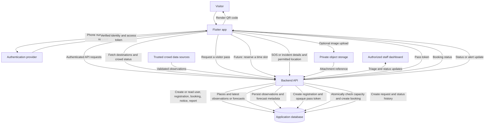

# Smart-Crowd-and-Experience-Management-for-Pilgrimage-and-Tourist-Sites

YatraFlow is a Flutter visitor-app prototype for pilgrimage and tourist destinations. Its current screens demonstrate phone-number onboarding, language selection, destination discovery, estimated crowd information, visitor registration, alerts, a travel assistant, and emergency reporting.

> **Prototype status:** The app currently uses in-memory/demo repositories. There is no backend API, database, live crowd feed, payment/booking service, or administrator dashboard connected. The workflow and data model below distinguish what works in the app today from a suggested backend design.

## Contents

- [Current capabilities](#current-capabilities)
- [Visitor app workflow](#visitor-app-workflow)
- [Architecture and data flow](#architecture-and-data-flow)
- [Persistence and database design](#persistence-and-database-design)
- [Project structure](#project-structure)
- [Run and test](#run-and-test)
- [Permissions and external services](#permissions-and-external-services)
- [Planned integrations](#planned-integrations)

## Current capabilities

- **Onboarding:** Select a country calling code, validate a phone number, and enter a six-digit demo OTP. `123456` is accepted; no SMS is sent.
- **Language:** English and Hindi can be selected. The choice is passed into the home screen and selected flows; some screens and sample content remain English-only.
- **Home:** Provides entry points to registration, nearby places, emergency support, the guide, and a keyword-matching travel assistant. The search bar, profile/menu, several tabs, and the Report Problem tile are presentation-only/incomplete.
- **Near Places:** Loads eight hard-coded Jaipur destinations. Visitors can search by name/category, sort by lower estimated crowd, sort by distance after granting location access, view a destination detail, see a simple illustrative forecast, and open directions in Google Maps.
- **Registration:** Collects an ID type/number, name, date of birth, and address; locally checks the fixed demo OTP; generates and displays a random demo QR payload; then shows a completion screen. No details or QR identity are submitted or saved.
- **Guide:** Displays sample weather, event, news, and information notices. Opening a notice marks it read in the current repository instance.
- **Emergency & Support:** Can obtain the device location, confirm an SOS and display a mock request ID/status; can also create a demo incident with an issue type, description, optional selected photo, and location. The app does not transmit the SOS or incident to staff. A separate button can open the phone dialer for emergency services.

Crowd percentages and suggested visiting times are sample values in code. The displayed forecast applies fixed offsets to the sample percentage; it is not an observed or predictive crowd model and must not be used for real-time safety decisions.

## Visitor app workflow

```text
Launch
  -> Mobile number and country code
  -> Request demo OTP (simulated delay; no SMS or server call)
  -> Verify 123456
  -> Choose English or Hindi
  -> Home
       |-> Near Places -> search/filter -> destination details -> external directions
       |-> Register -> identity details -> demo OTP -> generated demo QR -> completion
       |-> Guide -> sample alerts -> detail (read state held in memory)
       |-> Emergency & Support -> location -> confirm mock SOS -> mock status
       |                         \-> incident form -> optional photo/location -> mock ID
       \-> Travel assistant -> local keyword-based sample response
```

### Flow details

1. The entry screen validates the number using the selected country's configured length (and an additional Indian mobile-number check). It passes the number and country code to the OTP screen.
2. `DemoAuthService` simulates sending/verifying a code. A successful `123456` check navigates to language selection; an incorrect code remains on the screen with an error.
3. Language selection passes the selected language and phone number to `HomeScreen`. It is not persisted across app launches.
4. The home screen opens feature screens using in-app navigation. The visible registration data, chat conversation, selected filters, and other screen state live in widget/repository memory.
5. Near Places loads constant destination records from `PlacesService`. Search and crowd sorting run on-device. Near Me asks `LocationService` for a device position and calculates straight-line distance locally. Directions are handed to a Google Maps URL.
6. Registration validates required fields locally, reuses the demo OTP value, and generates a random QR value prefixed with `YATRAFLOW-`. The QR contains only that generated demo token; no registration record is written.
7. Guide loads sample notifications from `MockNotificationRepository`; marking a notice read changes that in-memory list only.
8. SOS and incident actions use `MockEmergencyRepository` by default. Location is acquired on-device, the UI asks for SOS confirmation, and the repository returns fabricated IDs. An incident photo stays as a local file path; it is not uploaded.

## Architecture and data flow

The application is a Flutter/Dart client. Screens own transient presentation state and call small service/repository abstractions:

| Area | Screen / entry point | Service or repository | Current data source / side effect |
|---|---|---|---|
| Authentication | `MobileNumberScreen`, `OtpVerificationScreen` | `DemoAuthService` | Fixed demo OTP and simulated delay; no authentication provider |
| Registration | `RegistrationFlowScreen` | `DemoAuthService.demoOtp` | Local form validation and random demo QR; no persistence |
| Destinations | `NearPlacesScreen`, `DestinationDetailScreen` | `PlacesService`, `LocationService` | Hard-coded Jaipur places; device location and external directions |
| Notices | `GuideScreen` | `NotificationRepository` / `MockNotificationRepository` | In-memory sample notices and read flags |
| Emergency | `EmergencySupportScreen`, `SosActiveScreen` | `EmergencyRepository` / `MockEmergencyRepository`, `LocationService` | Device location plus fabricated request/incident IDs |
| Assistant | Home chat panel | `ChatRepository` / `MockChatRepository` | Local keyword matching; no AI or remote chat service |

Repositories are useful seams for replacing demo implementations with API-backed implementations. At present, there is no configured base URL, API client, database package, Firebase/Supabase setup, database migration, or local persistence package. Restarting the app resets demo state.

## Persistence and database design

### What is stored today

There is **no database in the current project**. The app does not create database tables or persist user/profile, registration, booking, crowd, notification, SOS, or incident records. Data is either compiled into Dart source/assets or held temporarily in memory. Device location is read for an action and used locally; the app does not retain a location history.

Do not treat the current demo forms as production identity verification or the mock SOS screen as a real emergency dispatch channel.

### Suggested future logical model

The following is a technology-neutral starting point for a backend database. It is not implemented and can be adapted to a relational database or equivalent document model.

| Entity | Important fields | Relationships / purpose |
|---|---|---|
| `users` | `id`, `phone_e164` (unique), `preferred_language`, `created_at`, `updated_at`, `status` | One account can own registrations, bookings, and submitted reports. Store normalized phone numbers; never store OTP values. |
| `visitor_profiles` | `user_id` (unique FK), `full_name`, `date_of_birth`, `address`, `identity_type`, `identity_number_encrypted`, `verification_status`, timestamps | Optional sensitive profile data. Restrict access, encrypt identity data, and define retention/deletion rules before collecting real IDs. |
| `places` | `id`, `name`, `category`, `description`, `latitude`, `longitude`, `capacity`, `timezone`, `is_active` | Destination catalogue maintained by authorized staff. |
| `crowd_observations` | `id`, `place_id` (FK), `observed_at`, `occupancy`, `capacity`, `source`, `quality` | Time-series observations from trusted sensors/staff/feeds; access pattern should be indexed by `(place_id, observed_at)`. |
| `crowd_forecasts` | `id`, `place_id` (FK), `generated_at`, `valid_for`, `predicted_occupancy`, `model_version`, `confidence` | Predictions must be distinguishable from measured values and include freshness/provenance. |
| `registrations` | `id`, `user_id` (FK), `place_id` (FK, nullable if registration is not place-specific), `status`, `created_at`, `verified_at` | Stores the registration workflow state; identity data should be referenced from a protected profile rather than copied. |
| `visitor_passes` | `id`, `registration_id` (FK), `token_hash` (unique), `issued_at`, `expires_at`, `revoked_at` | QR should encode an opaque, signed/unguessable token—not personal details. Validate tokens server-side. |
| `bookings` | `id`, `user_id` (FK), `place_id` (FK), `slot_id` (FK), `party_size`, `status`, timestamps | Future reservation record; enforce slot capacity atomically to prevent overbooking. |
| `entry_slots` | `id`, `place_id` (FK), `starts_at`, `ends_at`, `capacity`, `reserved_count`, `status` | Time-window inventory used by bookings. |
| `notifications` | `id`, `place_id` (FK, nullable), `category`, `title`, `body`, `severity`, `published_at`, `expires_at`, `status` | Staff-authored or trusted-feed notices visible to visitors. |
| `notification_receipts` | `user_id` (FK), `notification_id` (FK), `read_at` | Per-user read state; composite key `(user_id, notification_id)`. |
| `sos_requests` | `id`, `user_id` (FK, nullable for guest SOS), `place_id` (FK, nullable), `latitude`, `longitude`, `status`, `submitted_at`, `acknowledged_at`, `resolved_at` | Auditable emergency workflow. Restrict access to responders and retain only as long as operationally/legal necessary. |
| `incident_reports` | `id`, `user_id` (FK, nullable), `place_id` (FK, nullable), `issue_type`, `description`, `latitude`, `longitude`, `status`, `created_at` | Non-urgent visitor reports and administrative triage. |
| `media_attachments` | `id`, `incident_report_id` (FK), `object_key`, `content_type`, `created_at` | Metadata for private object storage; store files outside the relational database and authorize access. |
| `staff_users` / `roles` | staff identity, role, status, audit timestamps | Future admin dashboard authorization. Apply least privilege and audit sensitive actions. |

Recommended constraints include unique normalized phone numbers and pass-token hashes, foreign keys for owned records, checks for valid status/occupancy/capacity ranges, indexes for place/time and user/time queries, and transactions for slot allocation. Define retention, consent, encryption, access control, audit logging, backups, and deletion policies before deploying real personal, location, or emergency data.

### Suggested backend request lifecycle

1. **Authentication:** Client requests an OTP from an authentication provider; provider verifies the code and returns a short-lived access token. The API upserts the user by verified phone number. OTPs and provider secrets are never stored by the app or database.
2. **Profile/registration:** Client submits validated profile data over TLS. API authorizes the user, validates fields, encrypts any government ID data, writes the registration in a transaction, and returns a registration ID plus opaque pass token. Client renders the QR from that token.
3. **Places and crowd:** Client fetches active places and the latest observation/forecast. API returns source and timestamp so the UI can show freshness and label estimated values; stale/unavailable readings should not be presented as live.
4. **Booking (future):** API reads available slots and creates a booking using a transaction/atomic capacity update. Client receives a booking ID and status; cancellation and refunds, if applicable, are explicit state transitions.
5. **Notices:** Client fetches published notices and records read receipts for the authenticated user. Staff publishing is a separate authorized operation.
6. **SOS / incident:** Client obtains explicit permission and confirmation, submits only required coordinates/details, and receives a server-generated tracking ID. The API records status changes and notifies the authorized response team. A successful HTTP response alone must not be described as dispatched/acknowledged unless the responder workflow confirms it.
7. **Administration:** A separate staff-facing authenticated interface manages places, slots, notices, crowd feeds, and report/SOS triage. Every privileged change is authorized and audited.

### Target app-to-database workflow (not yet implemented)

The diagram below shows how the Flutter app could communicate with production services. The current app stops at the mock/local behavior described above; it does not make these API calls or write to a database.



In this target design, the **Flutter app** gathers input, requests device permissions, and presents results. The **API** authenticates and authorizes requests, validates data, and coordinates transactions. The **database** is the durable source for user references, registrations, place data, bookings, notices, and request status. Private image files belong in **object storage**, with only access-controlled metadata/references in the database. Trusted crowd feeds and staff updates enter through secured services rather than being trusted directly from the visitor client.

## Project structure

```text
lib/
  main.dart                 App entry point, theme, locales
  auth/                     Demo authentication implementation
  screens/                  Onboarding and visitor-facing screens
  services/                 Place, notification, emergency, and chat repositories
  widgets/                  Shared authentication UI and buttons
assets/
  images/                   Bundled screen and destination imagery
test/
  widget_test.dart          Onboarding and visitor-flow widget tests
```

## Run and test

Prerequisites: Flutter SDK with a Dart SDK satisfying the constraint in `pubspec.yaml` (`^3.13.5`), and an Android/iOS device or emulator (or another Flutter-supported target).

```sh
flutter pub get
flutter run
```

Run the widget tests and static analysis with:

```sh
flutter test
flutter analyze
```

## Permissions and external services

- **Location:** Android declares fine and coarse location permissions. Near Me and emergency/report flows request location at runtime and handle denied/disabled location states. Location use is action-driven in this prototype.
- **Photo picker:** Incident reporting lets the visitor select an optional image from the gallery. The selected local path is passed to the mock repository only; no upload occurs.
- **Phone dialer:** The SOS status screen can launch `tel:112`. Availability depends on the platform/device.
- **Maps:** Destination directions open a Google Maps directions URL, subject to a compatible app/browser and network connection.
- **Network/database:** No application backend connection is currently configured. The `INTERNET` entries in Android debug/profile manifests are build-mode permissions, not evidence of a connected YatraFlow API.

## Planned integrations

To turn the prototype into a production visitor and operations system:

1. Select the backend, database, hosting, identity provider, and admin authentication approach.
2. Define API contracts and migrations for the logical entities above; add authorization, validation, audit, retention, and privacy controls.
3. Replace mock repositories with typed API implementations and explicit loading/error/empty states.
4. Integrate verified live data sources for crowd measurements, forecasting, notices, and capacity; publish freshness and provenance.
5. Implement registration/pass verification and slot booking end-to-end, including server-side validation and capacity-safe transactions.
6. Build the staff dashboard and verified alerting/dispatch workflow. Exercise SOS/report paths in a safe staging environment before any live use.
